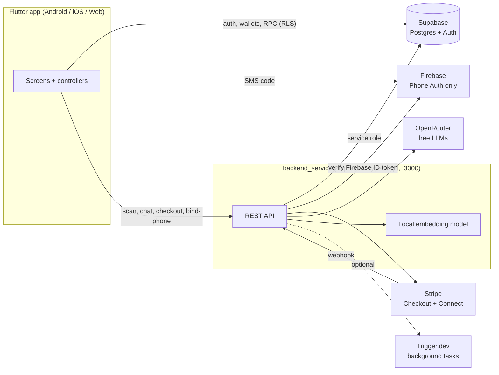

# Probashi Guard

**A bilingual (Bangla / English) mobile app that protects Bangladeshi migrant workers from recruitment and employment fraud, and gives them a safe way to hold and send money home.**

> **Taking over this project?** Read [SETUP.md](SETUP.md) first. It covers every account, key and dashboard setting the code depends on, and ends with a handover checklist. Most failures on a fresh machine are configuration, not code.
>
> **Never commit** `backend_service/.env`, `android/key.properties`, `android/app/google-services.json` or the release keystore. All four are gitignored. This is a **prototype**: payments run against the Stripe **sandbox** (test mode).

---

## What is Probashi Guard?

Workers heading abroad get handed contracts they can't read, asked to sign blank pages, and charged hidden fees. Probashi Guard puts a checker, a wallet and an assistant in their pocket:

- **Fraud checker.** Photograph a contract or visa, or scan a passport, and get a plain-language audit with a verdict: `SAFE_TO_SIGN`, `PROCEED_WITH_CAUTION` or `DO_NOT_SIGN`.
- **Wallet and remittance.** Three card wallets, transfers addressed by phone number, and sending money abroad through Stripe Checkout.
- **Notices.** A feed of migration and remittance news.
- **Prohori.** An AI assistant that answers from a curated FAQ, in Bangla or English.

---

## Features

| Area | What it does | Status |
|---|---|---|
| Sign-in | Email + password with a 6-digit signup code, Google and GitHub OAuth, code-based password reset | Working. Needs Supabase dashboard config ([SETUP §4](SETUP.md#4-supabase-dashboard-settings)) |
| Phone verification | Firebase Phone Auth proves the number; the backend binds it to the account | Working. Required before any money moves |
| Wallet | Three cards (WPS Payroll, Probashi Expatriate, Probashi Global Visa), each with its own ledger wallet | Working |
| Send money | Hold-to-confirm opens a hosted Stripe Checkout session in USD; the webhook books the result | Working in Stripe **test mode** |
| Card-to-card | Move money between your own cards via the `internal_transfer()` database function (no Stripe) | Working |
| Document scanner | Contracts and visas go to a vision model through OpenRouter; passports are read on-device (MRZ) | Working. Passport mode is Android/iOS only |
| Saved documents | A vault of audits you chose to keep | Working |
| Notices | Open Graph-scraped news cards cached in Supabase | Working. Re-run the seeder to refresh |
| Prohori chat | Retrieval-augmented answers from 78 FAQ entries (39 EN + 39 BN) | Working |
| Language, search, checklist, profile | EN/BN toggle, app-wide search, pre-departure checklist | Working |
| Complaint, Embassy contacts, Help & Support, About, Share app | Menu entries | **Placeholder** ("coming soon") |
| Passport & Visa, BMET card, Biometric, Change PIN, Linked devices, Notification management | Profile rows | **Placeholder** ("coming soon") |

---

## Requirements

| Tool | Version | Needed for |
|---|---|---|
| Flutter | 3.44.2 stable (Dart 3.12.2) | The app |
| Node.js + npm | 22 or newer | `backend_service` |
| Android Studio + Android SDK | current; bundled JDK 17 | Android builds |
| Git | any | |
| Chrome | any | Running the app on web |
| Stripe CLI | optional | Forwarding webhooks to your machine |
| Xcode | macOS only | iOS. **Not set up or tested** |

Accounts: **Supabase**, **Firebase**, **Stripe**, **OpenRouter**. **Trigger.dev** is optional. Google and GitHub OAuth apps are needed for social sign-in. Step-by-step setup for each is in [SETUP.md](SETUP.md).

---

## Installation

The short version. It assumes the accounts, keys and database already exist; if not, do [SETUP.md](SETUP.md) §3–§6 first.

```bash
git clone https://github.com/talhatanzim2005/Probashi_guard.git
cd Probashi_guard
```

### Backend (always needed)

```bash
cd backend_service
cp .env.example .env          # fill it in: see SETUP §3
npm install
npm run dev                   # http://localhost:3000/api/health
```

### Option 1: Android emulator or phone

```bash
# from the repo root
flutter pub get
flutter run                                                     # emulator: reaches the backend at 10.0.2.2:3000
flutter run --dart-define=BACKEND_URL=http://<PC-LAN-IP>:3000   # real phone on the same Wi-Fi
```

Needs `android/app/google-services.json` for phone verification. Without it the app still builds, and phone verification reports itself as not configured.

### Option 2: Chrome

```bash
flutter run -d chrome --web-port 5000     # keep the port: OAuth redirects depend on it
```

Add `http://localhost:5000/**` to Supabase's Redirect URLs. Passport scanning isn't available on web.

### First run

**Shortcut:** log in as `sender@example.com` / `Test1234!`. It's already verified and funded (sandbox data, SETUP §6).

1. Sign up with an email. A 6-digit code arrives by email.
2. The phone screen follows. It is skippable, but you can't send or receive money until a number is verified. In development use one of the ten Firebase **test numbers**, `+8801700000000` to `+8801700000009`, with the verification code **`123456`** for all of them. No SMS is sent (SETUP §3.2).
3. A new account has **0.00 on every card and no history**. There is no seed data. To get a starting balance, run `supabase/dev/fund_my_cards.sql` in the Supabase SQL editor (dev only).
4. Open the **Scan** tab and photograph a document. Nothing is saved until you tap *Save to vault*.
5. Open **Prohori** from the side menu. It needs the FAQ seeded first: `npm run seed:faqs`.

---

## Usage

### Backend scripts (`backend_service/`)

| Command | What it does |
|---|---|
| `npm run dev` | Start with auto-reload (`tsx watch`) |
| `npm run build` / `npm start` | Compile to `dist/` and run it (production) |
| `npm test` | Compile and run the backend test suites |
| `npm run seed:faqs` | Build Prohori's knowledge base. Add `-- --dry-run` to preview |
| `npm run seed:notices` | Scrape the news feed into Supabase. Add `-- --dry-run` to preview |
| `npm run pentest:*` | Security probes (`dos`, `auth`, `rls`, `arbitrage`, `mobile`). Run against a **local** backend only |

### App build-time flags

| Flag | Default | Purpose |
|---|---|---|
| `BACKEND_URL` | `http://10.0.2.2:3000` on Android, `http://localhost:3000` elsewhere | Where `backend_service` is. Use an `https://` URL for release builds |
| `SUPABASE_URL` | this project's URL (in `lib/main.dart`) | Point the app at another Supabase project |
| `SUPABASE_KEY` | this project's publishable key (in `lib/main.dart`) | Same. Use the **publishable** key, never the service-role key |

### Backend API

Base URL `http://localhost:3000`. Protected routes expect `Authorization: Bearer <Supabase access token>`.

| Method | Path | Auth | Purpose |
|---|---|---|---|
| GET | `/api/health` | none | Liveness check |
| POST | `/api/documents/scan` (alias `/analyze`) | session | Audit a contract or visa (1–10 page photos, or one PDF) |
| POST | `/api/documents/mrz` | session | Audit a passport from on-device MRZ fields |
| POST | `/api/documents/save` | session | Store a signed audit in the vault |
| POST | `/api/chat` | signed in | Prohori: `{ message, language? }` returns `{ reply, matched, model }` |
| POST | `/api/auth/bind-phone` | signed in | Bind a Firebase-verified phone number to the account |
| GET | `/api/rates` | none | Currency rates |
| POST | `/api/checkout/send-money` | verified phone | Create the Stripe Checkout session |
| GET | `/api/checkout/session-status/:id` | signed in | Poll whether a session is paid |
| POST | `/api/checkout/destination-charge` | signed in | Checkout to a connected account |
| POST | `/api/products/create` | signed in | Create a Stripe product and price |
| POST | `/api/connect/create-account` | signed in | Create a Stripe connected account |
| POST | `/api/connect/account-link` | signed in | Stripe onboarding link |
| GET | `/api/connect/account-status/:accountId` | signed in | Connected-account status |
| POST | `/api/webhooks/stripe` | Stripe signature | Books paid sessions, handles Connect events |
| GET | `/api/payment/cards`, `/beneficiaries`, `/transactions` | signed in | **Static sample data.** The app doesn't use these; it reads Supabase directly |
| GET | `/success`, `/cancel` | none | Pages Stripe redirects to after checkout |

Rate limits (in memory, per user or IP): chat 12/min, send-money 20/min, other Stripe routes 30/min. Body caps: 2 MB by default, 16 KB for chat, 20 MB for documents (8 MB per image, 16 MB per scan).

---

## Architecture



- **Supabase is the identity system and the database.** The app talks to it directly for sign-in and for reads protected by Row Level Security.
- **Firebase does one job:** proving a phone number by SMS.
- **`backend_service` holds every secret:** Stripe, OpenRouter, the Supabase service-role key, the Firebase token check. The app never holds these.
- **Money moves only through database functions.** Clients have no INSERT or UPDATE on `wallets` or `transactions`.

### Layout

```
.
├── lib/                              Flutter app
│   ├── main.dart                     Entry point, init order, 4-tab shell
│   ├── config/backend_config.dart    Where backend_service is (BACKEND_URL)
│   ├── l10n/                         app_strings.dart (all UI text), language_controller.dart
│   ├── theme/app_colors.dart         The four-colour palette
│   ├── widget/                       Shared app bar, bottom nav, small widgets
│   └── frontend/
│       ├── auth/                     login, register, OTP, forgot password, phone setup
│       ├── payment/                  wallet deck, send flow, repositories, controller
│       ├── documents/                scanner, audit detail, vault
│       ├── notice/                   news feed
│       ├── prohori/                  AI chat
│       └── home/ profile/ menu/ crChecker/ Complaint/ splash/
├── backend_service/                  Node + TypeScript API
│   ├── src/server.ts                 Entry point (port 3000)
│   ├── src/routes/                   auth, chat, checkout, connect, documents, payment, webhooks
│   ├── src/ai/                       OpenRouter client, embeddings, FAQ parser and store, Prohori prompt
│   ├── src/documents/                Fraud rules, passport identity parsing
│   ├── src/trigger/                  Trigger.dev tasks (stubs)
│   ├── scripts/                      seed_notices, seed_ai_faqs, pentest_*
│   └── .env.example                  Every environment variable, documented
├── supabase/
│   ├── migrations/                   Database schema, in order
│   └── dev/                          Dev-only funding scripts (not migrations)
├── instruction/                      Prohori's source FAQ (English and Bangla)
├── test/                             Flutter tests
├── docs/                             This README, SETUP.md, architecture, algorithms, security
├── STRIPE_INTEGRATION_TODO.md        Stripe go-live notes
└── android/ ios/ web/ …              Platform projects
```

`skills/`, `.agents/` and `.mcp.json` are AI-assistant tooling, not part of the app. `assests/` (sic) holds a few early design images; the app's own assets are in `assets/images/`.

### Tech stack

| Layer | Technology |
|---|---|
| App | Flutter, `supabase_flutter`, `firebase_auth`, `camera`, `passport_scanner` + `mrz_parser` (on-device MRZ), `url_launcher`, `shared_preferences` |
| Backend | Node.js, Express 5, TypeScript, `stripe` v23, `@supabase/supabase-js`, `jose`, `openai` SDK (pointed at OpenRouter), `@huggingface/transformers` |
| Database | Supabase Postgres with `pgvector` for FAQ search |
| Payments | Stripe Checkout (hosted) and Stripe Connect (v2 Core Accounts) |
| AI | OpenRouter free models: vision for documents, text for chat. Embeddings run locally (`Xenova/multilingual-e5-small`), so there is no embedding API cost |
| Background jobs | Trigger.dev v4. Tasks are stubs; the backend runs fine without it |
| Android | AGP 9.0.1, Gradle 9.1, Kotlin 2.3, JDK 17, package `com.probashiguard.app` |

### Design rules to keep

These came from product decisions and security fixes. They aren't obvious from the code, and breaking one tends to reopen a hole that was already closed.

**Money**
- Balances change only through `p2p_transfer()`, `internal_transfer()`, `deposit_to_wallet()` and `settle_remittance()`. Never fix a balance with a direct `UPDATE`; it will be refused.
- `deposit_to_wallet()` and `settle_remittance()` are granted to `service_role` only. If `authenticated` ever gets EXECUTE on either, any signed-in user can credit themselves.
- USD is the **settlement rail only**. Wallet balances stay in BDT: the sender types a local amount, Stripe charges USD, the recipient is paid locally. Don't convert stored balances to USD.
- Hold-to-confirm only **opens** a Stripe session. Money moves on `checkout.stripe.com`, which the app can't observe, so the app polls `session-status` and the webhook books the result. Treating hold-to-confirm as "paid" would report success for transfers nobody paid for.
- The payer's user id comes from a verified bearer token, never from the request body. The amount charged is derived on the server, never taken from the client.
- `payment_methods` has no column for a card number, CVV or account number, and must never get one. Only brand and `last4` are stored.

**Identity**
- A phone number must be **proven**, not claimed. `POST /api/auth/bind-phone` reads the number from the verified Firebase token's `phone_number` claim, never from the body. Both sender and recipient need a verified phone for a transfer.
- Nobody signs in anonymously any more. Login comes first. Data from older anonymous installs is carried over at login by `claim_anonymous_data()`.

**Scanner**
- A scan **never saves itself**. `/scan` and `/mrz` return an audit; only *Save to vault* calls `/save`. Discarding needs no request because nothing was written. Don't "fix" this back to auto-save.
- Passports are read on-device and only the parsed fields go to `/api/documents/mrz`. Visas and BMET cards aren't TD3 passports, so they go to the vision model.
- Hard fraud rules live in code (`backend_service/src/documents/fraudRules.ts`): minimum monthly salary SAR 1,000, loan-trap range, "Tip Shoi" blank-signature detection. They apply on top of whatever the model says, including when a result is saved.

**UI**
- All user-facing text goes through `AppStrings`: add a getter that calls `_p(english, bangla)`. Never write an inline `isBangla ? a : b`. An empty Bangla string falls back to English.
- The design allows **four colours only**: Cloud Dancer `#F5F2EB`, Royal Blue `#1A4B9C`, Emerald `#1E824C`, Crimson `#D32F2F`, plus the tints in `lib/theme/app_colors.dart`. Use `AppColors`, never ad-hoc colours.

**Database**
- Don't run `supabase db push` against the live project. Its migration history has drifted from the repo. See [SETUP §5](SETUP.md#5-database-migrations).

### Database

Supabase project `xfwxiawapksepskcevwe`. Row Level Security is on for every table.

| Table | Purpose |
|---|---|
| `profiles` | One per user. `phone` is the P2P address; `phone_verified_at` gates money movement |
| `wallets` | One ledger wallet **per card** (`card_id`). `balance >= 0` is enforced |
| `transactions` | Double-entry ledger. A transfer writes a debit and a credit leg sharing a `reference` |
| `payment_methods` | Brand and `last4` only |
| `saved_documents` | The vault. Owner can read; only the backend writes |
| `notices` | The news feed. Read-only to clients |
| `beneficiaries` | Saved recipients |
| `faq_embeddings` | Prohori's knowledge base. No client access at all |
| `anonymous_claims`, `rpc_rate_limits` | Support tables for data carry-over and rate limiting |
| `*_legacy_20261019` | The old wallet and transaction tables, renamed rather than dropped |

All 13 migrations are in [supabase/migrations/](../supabase/migrations/). `supabase/dev/` holds two dev-only scripts that fund test accounts; they aren't migrations.

---

## Configuration

Every backend variable is documented in [backend_service/.env.example](../backend_service/.env.example) and explained in [SETUP §3](SETUP.md#3-accounts-keys-and-where-they-go). What each one breaks if it's missing:

| Variable | If missing |
|---|---|
| `STRIPE_SECRET_KEY` | **The server won't start** |
| `SUPABASE_URL`, `SUPABASE_ANON_KEY`, `SUPABASE_SERVICE_ROLE_KEY` | Every signed-in route fails; chat and phone binding return 503 |
| `OPENROUTER_API_KEY` | Scanner and Prohori return 503 |
| `FIREBASE_PROJECT_ID` | `bind-phone` returns 503; nobody can verify a phone |
| `STRIPE_WEBHOOK_SECRET` | The webhook returns 500; paid sessions are never booked |
| `ANALYSIS_SIGNING_SECRET` | Fine in development. In production, *Save to vault* is refused |
| `TRIGGER_SECRET_KEY` | Background tasks are skipped. Optional |

In production set `NODE_ENV=production`. That ignores `FIREBASE_TEST_PHONES`, restricts CORS to `CORS_ORIGINS`, and makes the server refuse to boot if `DEV_AUTH_BYPASS=1` is still set.

---

## Testing

```bash
flutter analyze                                  # currently clean
flutter test test/document_scanner_test.dart     # run Flutter tests by file
flutter test test/localization_test.dart
cd backend_service && npm run test:hermetic      # 181 tests, no network, nothing live is touched
```

**Don't run a bare `flutter test`.** `test/verify_payment_run_test.dart` writes a transaction and a wallet update to the live Supabase project every time it runs. `npm test` runs the original backend suites too, which load `backend_service/.env` and create a Stripe test-mode account on every run: prefer `npm run test:hermetic`, which replaces Supabase, Stripe, OpenRouter and Firebase with in-process fakes and runs the repo's migrations on an in-memory Postgres.

Test cases, test accounts and phones (`+8801700000000` to `+8801700000009`, code `123456`), the smoke script (`npm run e2e:live`) and the list of tests that fail on purpose because they describe a known defect are in [TESTCASES.md](TESTCASES.md).

---

## Troubleshooting

| Problem | Fix |
|---|---|
| Sending money shows "Payment Gateway Error" | `backend_service` isn't running, or `BACKEND_URL` is wrong. This is by design, not a regression |
| "Cannot reach the scanner server" | Same. On a real phone, set `BACKEND_URL` to the PC's LAN IP and allow port 3000 through the firewall |
| Backend exits on start with "Missing STRIPE_SECRET_KEY" | Set it in `backend_service/.env`. A test-mode key is fine |
| The signup or reset code never arrives | The Supabase email templates must contain `{{ .Token }}`. See SETUP §4 |
| Google/GitHub sign-in "succeeds, then goes nowhere" on Chrome | The Redirect URL doesn't match the page's port. Use `--web-port 5000` and allow `http://localhost:5000/**` |
| Phone screen says verification isn't set up | `android/app/google-services.json` is missing, or Firebase failed to initialise |
| Phone verification works in debug but not in a release build | The release (and Play App Signing) SHA fingerprints aren't registered in Firebase |
| `403 phone_not_verified` when sending | The account has no verified phone. Verify one from Profile → Update Phone Number |
| Prohori returns 503 | `OPENROUTER_API_KEY` unset, `faq_embeddings` empty (`npm run seed:faqs`), or the embedding model changed since seeding (re-run the seeder) |
| Scans fail with model errors (403/404/429) | OpenRouter withdrew a free model. Update `DOCUMENT_MODELS` in `.env` |
| Android: "Could not close incremental caches" | `kotlin.incremental=false` is missing from `android/gradle.properties` |
| Android: "File google-services.json is missing" | The Gradle plugin is applied unconditionally. Restore the `if (file("google-services.json").exists())` guard |
| Android: failure at `:app:checkDebugAarMetadata` | `permission_handler` moved to 13.x. Keep it at `^12.0.3` |
| Test fails with Postgres `42501` | The test client has no signed-in session. Don't loosen RLS to make it pass |
| After merging a teammate's branch the scanner or login vanished | Re-check `pubspec.yaml` dependencies, `_initSupabase()` in `main.dart`, and the Android manifest. See SETUP §11 |

More in [SETUP.md](SETUP.md#11-troubleshooting).

---

## Known issues and next steps

- **Placeholders.** The "coming soon" features above are unbuilt. `CrCheckerView` is a stub; *Fraud Checker* opens the scanner instead.
- **Prototype on the Stripe sandbox.** [STRIPE_INTEGRATION_TODO.md](../STRIPE_INTEGRATION_TODO.md) lists what to switch for live.
- **Hard-coded Stripe test account.** `stripe_payment_repository.dart` and `supabase_payment_repository.dart` fall back to a fixed `acct_…` connected account when none is passed. Replace this with real onboarding before going live.
- **"Return to App" on the `/success` page** uses a `probashiguard://` link no platform has registered. The app learns the payment finished by polling, so only that button is affected.
- **iOS is untested.** The bundle id is still `com.example.probashiGuard`, there is no `GoogleService-Info.plist`, and no iOS build has been verified.
- **Stub background tasks.** `backend_service/src/trigger/paymentTasks.ts` only logs. It sends no SMS and reconciles nothing.
- **In-memory rate limiter.** It's per process. Move it to Redis before running more than one backend instance.
- **Free LLM models come and go.** The backend tries a list in order; update `DOCUMENT_MODELS` / `CHAT_MODELS` when one disappears.
- **No deployment config.** The repo has no Dockerfile, CI or hosting setup.
- **Teammate pushes can undo wiring.** Past UI commits overwrote `pubspec.yaml` dependencies, Supabase init in `main.dart`, and Android config. After merging someone's branch, check those first.

---

## Documentation

| File | Contents |
|---|---|
| [SETUP.md](SETUP.md) | Accounts and keys, migrations, running, releasing, troubleshooting, handover checklist |
| [SYSTEM_ARCHITECTURE.md](SYSTEM_ARCHITECTURE.md) | What the system is, its context, technology stack and structure |
| [CORE_ALGORITHM.md](CORE_ALGORITHM.md) | The core algorithms, starting with the document fraud audit |
| [SECURITY_DESIGN.md](SECURITY_DESIGN.md) | Security design and audit, with findings |
| [TESTCASES.md](TESTCASES.md) | Automated suites, manual test cases, test accounts and phones, the live smoke script, and the known-defect register |
| [backend_service/.env.example](../backend_service/.env.example) | Every backend environment variable |
| [STRIPE_INTEGRATION_TODO.md](../STRIPE_INTEGRATION_TODO.md) | Stripe go-live notes |
| [.plans/payment-feature-spec.md](../.plans/payment-feature-spec.md) | Original payment feature spec |
| [instruction/](../instruction/) | Prohori's FAQ source, in English and Bangla |

## License

No license file yet. Decide on a license before the code is shared more widely.
